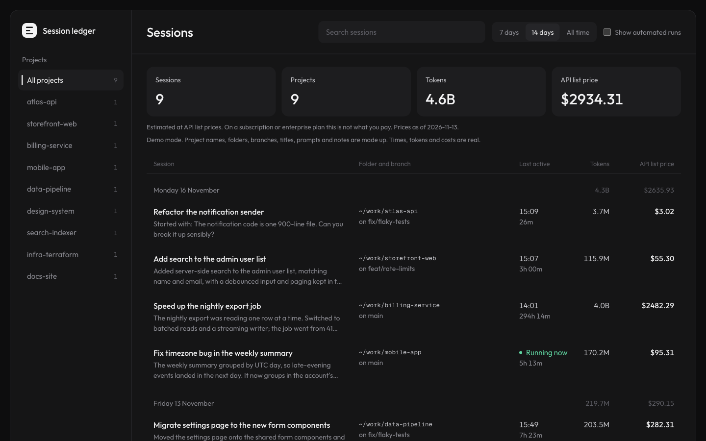
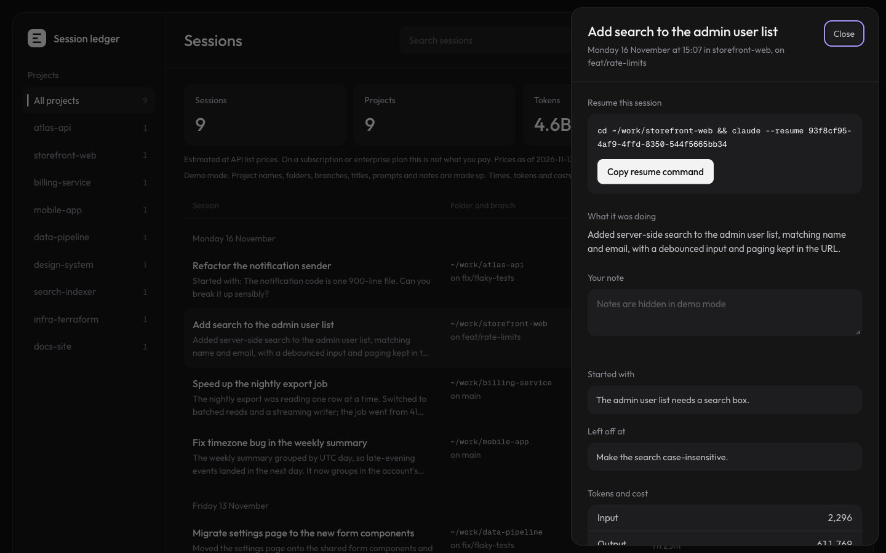
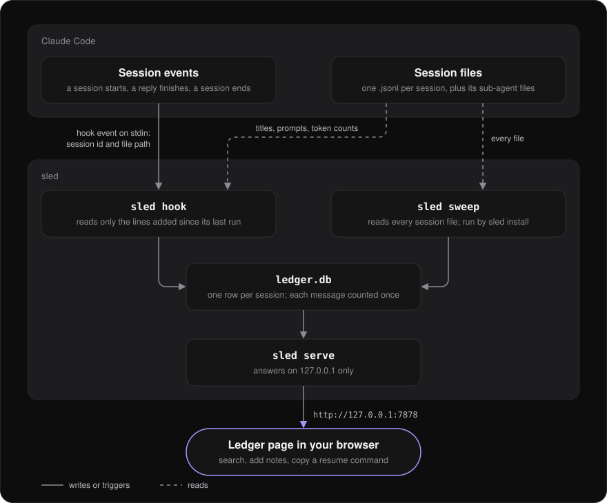

# sled

sled is a ledger of your Claude Code sessions. It records each session's title, project, branch, time spent, token counts and an estimated cost in a local SQLite database. A small page served from your own machine lets you search sessions, add notes, and copy a command that resumes any session.

Nothing in sled makes an outbound network request. The page is served on `127.0.0.1` only.





The screenshots were taken in demo mode (`sled serve --demo`), so the project names, titles and prompts in them are made up.

## Install

You need a Rust toolchain.

```sh
cargo install --git https://github.com/hitesh-yadav-x/sled
sled install
```

Or clone this repository and run `cargo install --path .` in it, then `sled install`.

`sled install` does four things:

1. Adds a `sled hook` command to the `SessionStart`, `Stop` and `SessionEnd` hooks in Claude Code's `settings.json`, each with a 10-second `timeout`. Your other hooks and settings are left alone.
2. If it changes an existing `settings.json`, first saves a backup of the old file next to it, named `settings.json.sled-backup-<date>-<time>`. When nothing needs to change, no backup is made.
3. Asks whether to raise Claude Code's session retention (see "Retention" below).
4. Scans the session files already on disk and prints how many sessions it indexed.

`sled install` records the binary's current path in the hook command. If you move or reinstall the binary somewhere else, run `sled install` again so the hook points at the new path. Running it twice is safe.

If `settings.json` is not valid JSON, or its `hooks` entries have an unexpected shape, `sled install` stops with an error and changes nothing.

sled reads Claude Code's folder from `$CLAUDE_CONFIG_DIR`, or `~/.claude` if that is not set. Its own data goes in `$SLED_DATA_DIR`, or `<claude folder>/session-ledger` if that is not set.

## Commands

```sh
sled install     # add the hooks and scan existing sessions
sled sweep       # rescan all session files and update the ledger
sled serve       # serve the ledger page and print its address (http://127.0.0.1:7878)
sled uninstall   # remove the hooks
```

`sled serve --demo` is for showing the page to other people. Project names, folders, branches, titles, descriptions, prompts and notes are replaced with made-up text before anything reaches the browser, and notes cannot be edited. Times, token counts, costs and session ids stay real, and so do model names that are in the price table; any other model name is shown as "custom model".

`sled install` also takes `--retention-days N` (set retention without asking) and `--keep-retention` (leave retention alone without asking). `sled serve` takes `--port N`; it does not open a browser, so open the address it prints.

Run `sled sweep --rebuild` after upgrading sled to re-read every session whose file still exists with the new reading rules; it never removes stored usage, and sessions whose files are gone and all your notes are left as they are.

There is also `sled hook`, which Claude Code runs for you. It reads the event from stdin, updates the ledger, prints nothing and always exits with status 0. Any error goes to `hook.log` in the data folder; the log is moved to `hook.log.1` when it passes 256 KB. The hook makes no network or model call.

The page hides automated runs (sessions started by scripts or the SDK, and sessions with no prompt at all) until you switch on "Show automated runs". A session that starts with a slash command, such as `/review the auth module`, is not automated: it appears with the command as its first prompt.

## How it works



<details>
<summary>Text version of the diagram</summary>

```text
  Claude Code session
        |
        |  a session starts, a reply finishes, or a session ends
        |  (the SessionStart, Stop and SessionEnd hooks)
        v
  sled hook                 reads the event from stdin: session id and
        |                   the path of the session file
        v
  session file (.jsonl)     reads only the lines added since last time,
  and its sub-agent files   and keeps titles, prompts and token counts
        |
        v
  ledger.db                 one row per session; tokens counted once
        |                   per message
        v
  sled serve                reads the ledger when you open the page
        |
        v
  http://127.0.0.1:7878     search, add notes, copy a resume command
```

</details>

1. Claude Code runs `sled hook` when a session starts, each time a reply finishes, and when a session ends.
2. The hook reads the event from stdin, which names the session and its session file.
3. It reads only what was added to that file, and to the session's sub-agent files, since its last run. That keeps a run short even on a very large session.
4. It updates the session's row in `ledger.db`. Any error goes to `hook.log`; the hook prints nothing, always exits with status 0, and makes no network or model call, so it cannot interrupt a session.
5. `sled serve` reads the ledger and shows it on a page on your own machine. The page refreshes every 30 seconds.

`sled sweep` does the same reading for every session file on disk. `sled install` runs it once, so sessions from before the install appear too.

## What is stored

The database is `ledger.db` in the data folder (WAL mode). For each session sled stores:

- the session id, project folder, git branch, path to the session file, and how the session was started (its entry point)
- start time, last activity time, and active time
- Claude Code's title and recap, when present, cut to 300 and 500 characters
- the first and last prompt, each cut to 300 characters
- token counts per model, one record per message: the message and request ids, the day, the service tier and speed, the number of web searches, and whether it came from the main conversation or a sub-agent
- for each session file and sub-agent file, its path and how far sled has read
- your own notes

sled does not store the rest of the conversation: no replies, tool output or file contents. Outside the database, `hook.log` can hold file paths from error messages, and a note you typed that has not been saved yet is kept in your browser's storage for the page until it saves. Token usage is counted once per message, so retried or repeated log lines are not double-counted.

Rows are never deleted. If Claude Code deletes a session file, the row stays, with its notes and totals, and is marked as not resumable.

## How time is counted

The duration shown for a session is active time, not clock time. sled adds up the gaps between consecutive entries in the session file and leaves out any gap longer than 15 minutes. A session left open overnight, or with the laptop closed, shows only the time you worked in it.

- A pause of under 15 minutes counts, even if you were away.
- A single step that runs for more than 15 minutes without writing to the session file is left out, so very heavy sessions can read slightly low.
- The wait before your first prompt is not counted.

"Running now" means the session has not ended and was active in the last 10 minutes. A session left open stops showing as running about 10 minutes after its last activity.

A session's tokens and cost all sit on the day it was last active.

## Cost is an estimate

The dollar figure on the page is an estimate at Anthropic's API list prices, worked out from token counts. It is not a bill. If you use Claude Code on a subscription or an enterprise plan, it is not what you pay.

The built-in prices were read from Anthropic's pricing page on the date in `as_of` at the top of `assets/prices.toml`, and the page shows that date. Prices change, so check that date, and override any price you need to (see below).

Models are matched by exact id, or by an id from the table followed by a date suffix such as `-20260101`. A model that is not in the table is shown as "price unknown" rather than being priced like a similar model. If a session mixes known and unknown models, its cost covers only the known ones and is shown with a trailing `+`.

The table shows each session's combined total, and the session drawer shows how its tokens and cost split between the main conversation and its sub-agents.

## Config file

Settings live in `config.toml` in the data folder. The file is optional; every key has a default.

```toml
port = 7878
cost_mode = "list"    # "list", "custom" or "tokens"
multiplier = 1.0      # used only when cost_mode = "custom"

# Replace the price of one model. Values are USD per million tokens.
[prices."claude-example-1"]
input = 3.0
output = 15.0
cache_read = 0.3
cache_write_5m = 3.75
cache_write_1h = 6.0
```

The three `cost_mode` values:

- `list`: the estimate at list prices. This is the default.
- `custom`: the list-price estimate multiplied by `multiplier`. Use it if you pay a negotiated rate, for example `multiplier = 0.8`.
- `tokens`: show token counts only and no dollar figure.

A `[prices."<model>"]` table replaces the built-in entry for that model id, or adds a model the table lacks. It must give all five rates shown above. It may also hold `[prices."<model>".fast]` and `[prices."<model>".batch]` sub-tables with the same five keys, and a `long_context` table with `threshold_tokens` plus the five rates; see `assets/prices.toml` for examples. If `config.toml` is malformed, `sled serve` stops with an error naming the file.

## Retention

Claude Code deletes session files after `cleanupPeriodDays` days (30 if unset). Once a file is gone the session cannot be resumed, though sled keeps its row.

During `sled install`, if retention is below 365 days and you are at a terminal, sled asks whether to set it to 365. This uses more disk. The answer is no unless you type `y`. `--retention-days N` sets it to N without asking, and `--keep-retention` skips the question. sled only ever raises the value: if yours is already higher than what you ask for, it is left as it is.

## Uninstall

```sh
sled uninstall
```

This removes only the sled hook commands from `settings.json` (after saving a backup, when there was something to remove) and prunes any hook lists that this leaves empty. It does not change the retention setting and does not delete the data folder. To remove your data too, delete the data folder yourself.

## Known limits

- Built and tested on macOS. Linux should work. Windows is not supported.
- A session appears on the page once its first reply has finished, and the page refreshes every 30 seconds.
- A forked session shows the original session's start time, first prompt and duration. Its tokens are counted once.
- Model ids from Amazon Bedrock and Google Vertex AI are not in the built-in price table, so they show "price unknown" until you add them under `[prices]` in `config.toml`.
- No resume command is offered for a session whose folder name has control characters, invisible characters or a backslash, because such a command is unsafe to paste into a terminal.
- `sled install` and `sled uninstall` treat any hook command that runs a program named `sled` with the argument `hook` as their own. A backup of `settings.json` is saved before any change.
- The page has no login. It answers only on `127.0.0.1`, but another account on the same machine can open it while `sled serve` is running.
- Sessions whose entry point starts with `sdk`, and sessions with no prompt, are treated as automated runs and hidden by default.
- Cache prices for fast and batch mode in `assets/prices.toml` are worked out from the multipliers Anthropic's pricing page states, because the page does not list them as figures.

## License

sled is released under the MIT License; see `LICENSE`.

The two embedded fonts, Outfit and Geist Mono, are under the SIL Open Font License. Their licence texts are in `assets/fonts/`.
